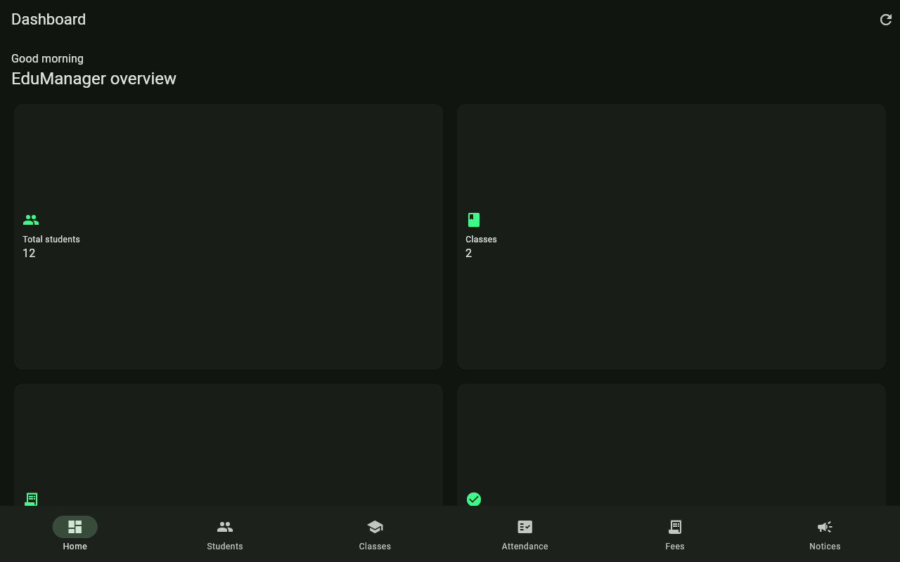
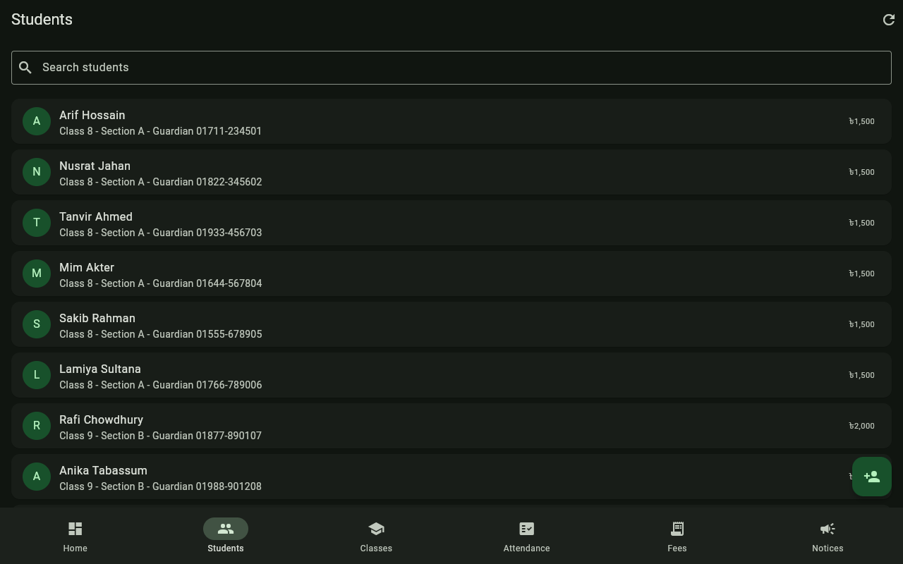
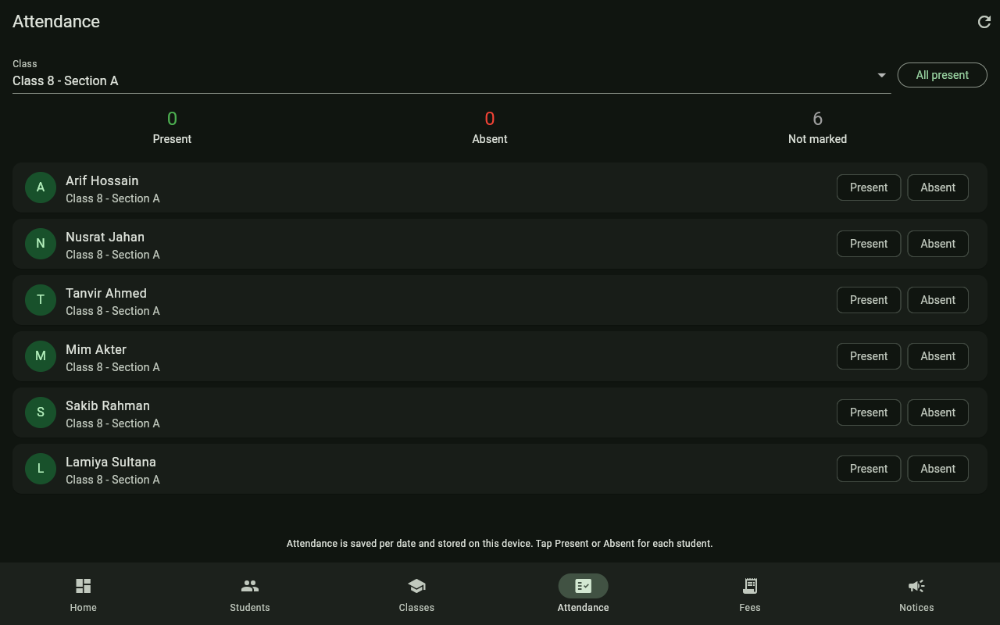
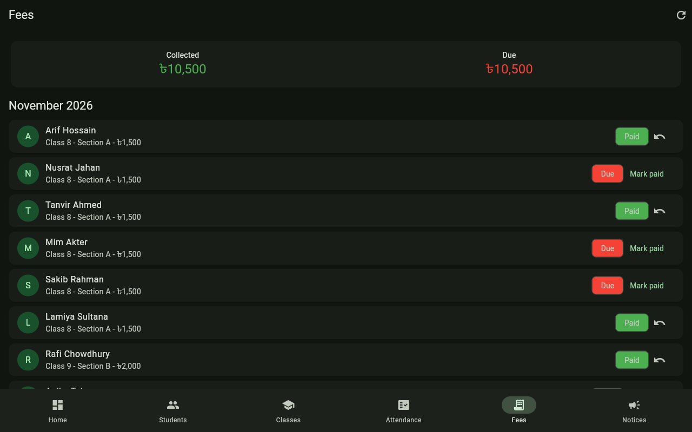

# EduManager

Education management mini app for schools and coaching centres. Built with Flutter and Material 3. Part of a one app per day reference build series by Partho Sarothi Paik.

Try it in your browser: https://codebypartho.github.io/edu-manager/

## Download the APK

Download the APK from the [v1.1.0 release](https://github.com/CodeByPartho/edu-manager/releases) on GitHub.

## Screenshots






## What it does

- Dashboard: total students, classes, fees due count and amount, present today, and the latest notice
- Students: searchable list with guardian phone and monthly fee, add a student (name, class, section, guardian phone, monthly fee), long press to remove
- Classes: class list with room and student count, expandable student roster, add a class
- Timetable: weekly class schedule on the Timetable tab of the Classes screen, five periods Monday to Friday per class with subject and teacher, add or delete a lesson
- Results: exam marks per student per subject with totals, percentage, GPA, grade and class rank, add marks for any exam and subject, share a result summary as copyable text for the guardian
- Attendance: mark present or absent per class for today, with present, absent and not marked counts, plus an All present button. Saved per date on the device. Absent students have a copyable absence notice for the guardian
- Fees: monthly fee list per student with paid and due status, mark paid and undo, collected and due totals for the current month. Paid fees have a copyable receipt with a receipt number, and due fees have a copyable fee reminder for the guardian
- Notices: notice board to post and delete notices
- Reset data: a refresh button in the top bar opens a confirmation dialog with two choices, Clear all data to start clean, or Restore demo data to bring back the original demo classes and students

Grades use the usual board scale: A+ at 80 and above, A at 70, A- at 60, B at 50, C at 40, D at 33, F below 33. Guardian messages are copyable text only; the app does not send messages itself.

## Data

Everything is stored locally with shared_preferences as JSON. No account, no server, no network calls. The first launch seeds demo data: 2 classes (Class 8 Section A, Class 9 Section B) and 12 students, with about half of the current month fees already paid and one day of attendance history, plus Monthly Exam results in four subjects for every student and a five period weekly timetable for both classes. Use the reset option in the top bar to clear everything or restore the demo data at any time.

## Tech

- Flutter 3.47.9, Material 3 dark theme, accent #39FF88
- State: provider
- Dates: intl
- Storage: shared_preferences

## Run

```sh
flutter pub get
flutter run
```

## Test

```sh
flutter analyze
flutter test
flutter build web --release
```

Unit tests cover fee totals (due, collected, due count, missing month fill), attendance counting (present, absent, unmarked, percentage ignoring unmarked days), exam grades and result summaries (grade bands, GPA, pass and fail, class rank with ties), timetable (day filtering, period order, slot conflicts), fee receipts and guardian message text, and data reset (clear all, restore demo data, and persistence of both).

## Project structure

- `lib/main.dart` app entry and dark theme
- `lib/models/models.dart` Student, SchoolClass, FeePayment, Notice, ExamResult, TimetableEntry
- `lib/logic/edu_logic.dart` pure fee, attendance, grade, result, timetable, receipt and guardian message logic
- `lib/state/edu_state.dart` state, persistence and demo seed
- `lib/screens/` dashboard, students, classes, timetable, results, attendance, fees, notices, main shell, copyable message dialog
- `lib/utils/format.dart` taka and date formatting
- `test/edu_logic_test.dart` unit tests
- `test/edu_results_test.dart` grade, result, timetable, receipt and message tests
- `test/edu_state_test.dart` reset and persistence tests
